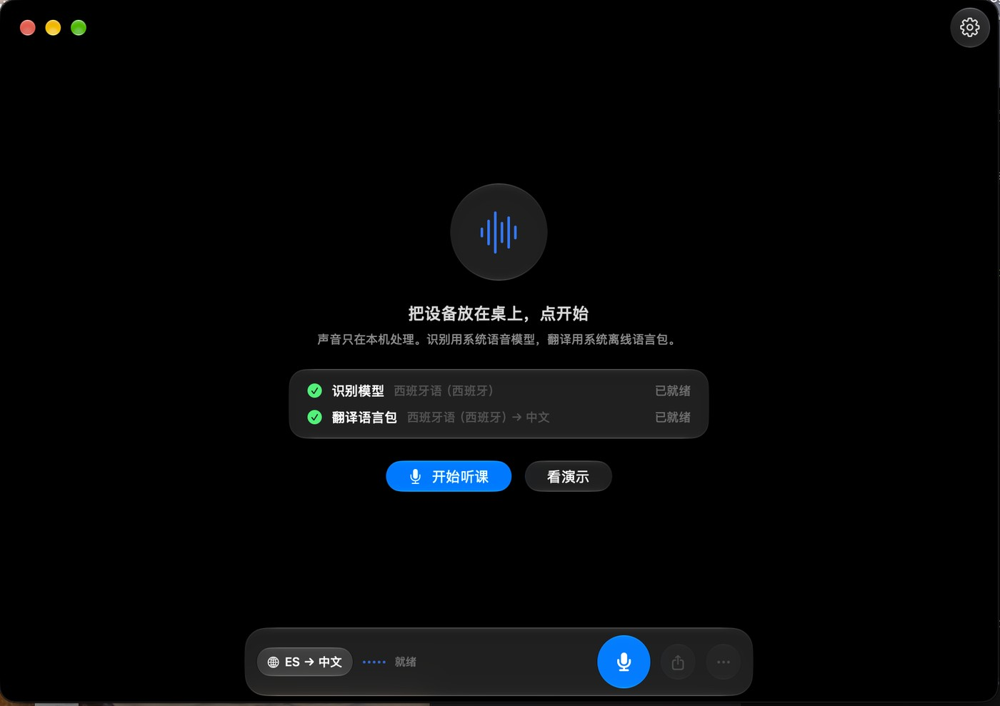

# Transclase · 课堂同传

> macOS 上的实时课堂双语字幕。全程本地运行，不需要注册，音频不出设备。

---

官网：https://jlz0614.github.io/transclase/

## 它解决什么问题

上课听不懂，通常不是"单词不认识"，而是三件事叠在一起：

1. **听不清** —— 教室太大、讲师有口音、后排有回声
2. **翻不准** —— 通用翻译软件不认识你专业的术语
3. **记不住** —— 听懂了，但两小时后全忘了

所以这个 App 不是"翻译器"，是**课堂同传 + 逐字稿**：把一节课变成能跟上的双语字幕，课后还能导出复习。

## 功能

- **实时双语字幕**：原文小字 + 译文大字，字号可调，可只留译文
- **稳定渲染**：每句按音频时间码生成行 ID，同一句只原地更新，永不跳行
- **底部对齐**：最新一句始终停在同一个阅读位置
- **离线准备**：首页显示识别模型 / 翻译语言包是否就绪，带真实下载进度
- **模型管理**：查看本机已下载的识别与翻译模型
- **两种翻译引擎**：系统离线 / 云端 API，随时切换
- **翻译助手**：一键总结、1–10 分钟自动总结、基于逐字稿的问答
- **三栏界面**：工作区按星期+日期归档每节课的 Markdown
- **7 种界面语言**：中 / 英 / 西 / 法 / 德 / 日 / 韩，切换即时生效
- **导出**：双语逐字稿（复制 / 分享），或只含原语言的 Markdown 文件（位置自选）
- **演示模式**：没有麦克风、没有语言包也能先看效果

## 系统要求

| | 要求 |
|---|---|
| 系统 | **macOS 26.0+**（`SpeechAnalyzer` 从这一代才有） |
| 芯片 | **Apple Silicon**（M1 及以后）。Intel 能打开，但实时识别不可用，只能看演示 |
| 构建 | Xcode 27 / Swift 6.4 |
| 可选 | Apple 智能（语言包缺失时的兜底翻译，需支持的设备） |

## 下载

Transclase 通过 Mac App Store 与 iOS App Store 分发。源码仓库不对外公开。

- 隐私政策：https://jlz0614.github.io/transclase-site/privacy.html
- 支持：https://jlz0614.github.io/transclase-site/support.html
