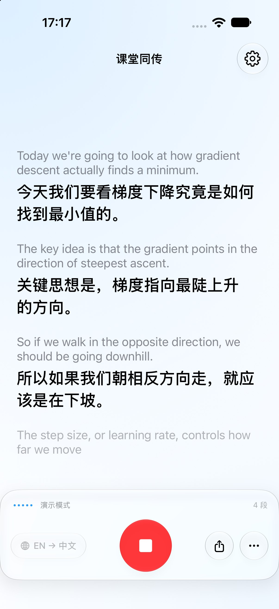
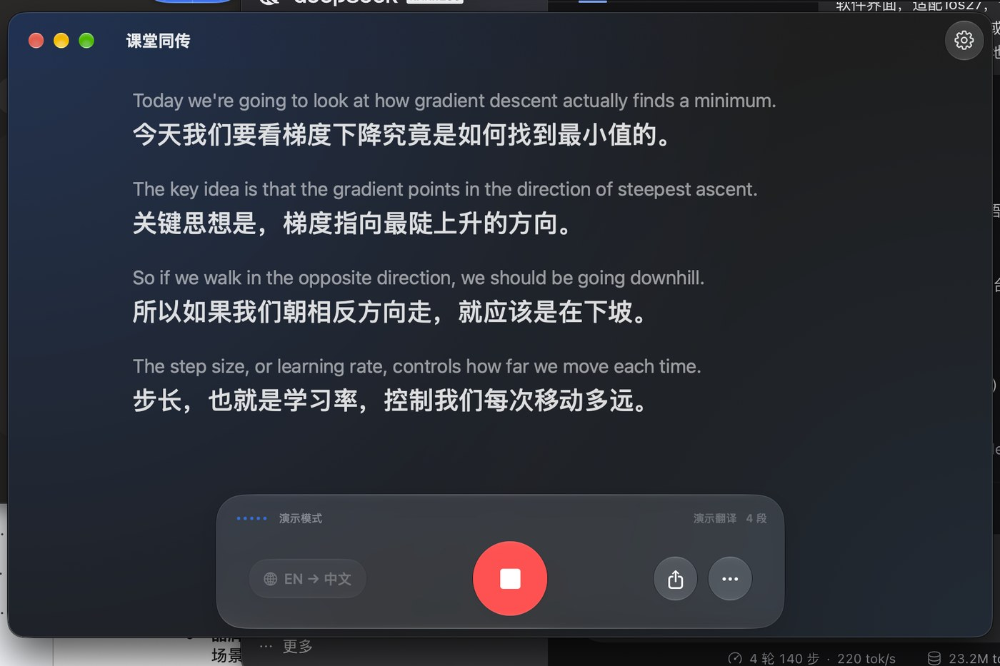

# Transclase · 课堂同传

> 留学生上课用的实时双语字幕工具。macOS / iPadOS / iOS 三端共用一套代码，
> 全程本地运行，不需要注册，音频不出设备。



<p align="center"></p>

---

## 它解决什么问题

上课听不懂，通常不是"单词不认识"，而是三件事叠在一起：

1. **听不清** —— 教室太大、讲师有口音、后排有回声
2. **翻不准** —— 通用翻译软件不认识你专业的术语
3. **记不住** —— 听懂了，但两小时后全忘了

所以这个 App 不是"翻译器"，是**课堂同传 + 逐字稿**：把一节课变成能跟上的双语字幕，课后还能导出复习。

## 功能

- **实时双语字幕**：原文小字 + 译文大字，字号可调，可只留译文
- **稳定渲染**：每句按音频时间码生成行 ID，同一句只原地更新，永不跳行
- **底部对齐**：最新一句始终停在同一个阅读位置
- **术语表**：课程级词表，纠正模型把专有名词、缩写原样留下的问题
- **离线优先**：识别与翻译都用系统端侧模型，飞行模式可用
- **三级翻译降级**：系统离线翻译 → Apple 智能 → 仅原文
- **导出**：双语 Markdown 逐字稿，走系统分享
- **演示模式**：没有麦克风、没有语言包也能先看效果

## 系统要求

| | 要求 |
|---|---|
| 系统 | **macOS 26.0+** / **iOS 26.0+**（`SpeechAnalyzer` 从这一代才有） |
| 构建 | Xcode 27 / Swift 6.4 |
| 设备 | 任意 M 系列 Mac、iPhone、iPad |
| 可选 | Apple 智能（语言包缺失时的兜底翻译，需要支持的设备） |

> iOS 版必须真机验证：`Translation` 框架不支持模拟器。

## 下载与安装

### 方式一：直接下载（macOS，免编译）

去 [**Releases**](https://github.com/JLZ0614/transclase/releases/latest) 下载 `Transclase-1.0.0-macOS.zip`：

1. 解压，得到 `Transclase.app`、`install.command`、`安装说明.txt`
2. **右键** `install.command` → 打开 → 再点一次「打开」
3. 脚本会装进「应用程序」并自动启动

也可以手动：把 App 拖进「应用程序」，然后在终端执行
`xattr -dr com.apple.quarantine /Applications/Transclase.app`

> 为什么多这一步：这个包用的是临时签名（ad-hoc），没有 Apple 开发者签名与公证，
> macOS 会给下载的文件打"隔离"标记。上面的操作只是去掉这个标记，不改动 App 内容。
> 想要真正"双击即用"，需要开发者证书 + 公证，见下方「独立分发」。

包是 Intel + Apple Silicon 通用二进制，但**语音识别需要 Apple Silicon**，Intel 机器只能跑演示模式。

### 方式二：从源码构建

```bash
git clone https://github.com/JLZ0614/transclase.git
cd transclase
open Transclase.xcodeproj
```

在 Xcode 里选 `Transclase` scheme → 选 `My Mac` / 任一 iPad / iPhone → `⌘R`。

macOS 版本地直接能跑（工程用了临时签名）。装到真机需要改签名，见下一节。

### 方式三：装到 iPhone

1. Xcode 打开工程，点左侧 `Transclase` 项目 → **Signing & Capabilities**
2. **Team** 选你的 Apple ID（没有就点 *Add an Account*，免费账号即可）
3. 把 **Bundle Identifier** 改成全球唯一的，例如 `com.yourname.transclase`
4. iPhone 用数据线连 Mac，手机上打开 **设置 → 隐私与安全性 → 开发者模式**
5. Xcode 顶部设备选你的 iPhone → `⌘R`
6. 首次运行若提示"不受信任的开发者"：手机 **设置 → 通用 → VPN 与设备管理** → 信任你的证书

> 免费账号签的包 **7 天后过期**，重连 Xcode 按一次 `⌘R` 即可续期。
> 有 99 美元的开发者账号则可以签一年，并用 TestFlight 分发。

## 使用教程

### 1. 第一次打开

App 会弹出系统的「下载语言包」面板，点 **Download**（每种语言几十 MB）。
不点也能用，但会走备用引擎或只显示原文。

想先看效果：把设备放在桌上，点中间蓝色麦克风按钮，或者点 **看演示**。

### 2. 上课时怎么放

| 场景 | 建议 |
|---|---|
| 线下课 | 手机/电脑放在桌上，麦克风朝向讲师，尽量坐前 5 排 |
| 网课（Mac） | 直接放桌上即可，系统会收环境音 |
| 网课（iPhone） | 外放音量开大一些，或戴耳机让手机收麦克风 |

底部那条控制栏从左到右是：语言对 → 音量条 → 状态 → 开始/停止 → 分享 → 更多。

### 3. 术语表（最值得花 5 分钟的地方）

**设置 → 课程术语表**，把你这门课的行话填进去：

| 原文术语 | 译法 |
|---|---|
| gradient descent | 梯度下降 |
| opportunity cost | 机会成本 |
| randomized controlled trial | 随机对照试验 |

同一个词在一节课里保持同一种译法，比偶尔译得更漂亮更重要。
不用一次填完，边上课边补也行。

### 4. 课后复习

点控制栏的分享按钮，导出双语 Markdown；或点 `⋯` → 复制全文 / 复制为 Markdown。

### 5. 快捷键（macOS）

| 快捷键 | 作用 |
|---|---|
| `⌘R` | 开始 / 停止 |
| `⌘K` | 清空字幕（会二次确认） |

## 关于语言包（常见问题）

**Q：为什么一定要下语言包？不能直接用系统自带的吗？**

A：Apple 的翻译模型**就是**语言包本身，没有"预装好、随时可用"的版本。没下载时
`TranslationSession` 会直接抛 `notInstalled`，没有绕过方式。

**Q：那不下语言包就完全不能翻？**

A：不是。App 有三级降级：

| 顺序 | 引擎 | 前提 | 质量 |
|---|---|---|---|
| 1 | 系统离线翻译 | 该语言对语言包已下载 | 最好 |
| 2 | Apple 智能（端侧大模型） | 设备支持且已开启 | 中 |
| 3 | 仅原文 | 上面都不满足 | — |

**Q：语言包装在哪？删 App 会丢吗？**

A：由系统服务管理，是全局资产。App 拿不到文件，只能通过 API 调用。删 App 不会删包，
和系统「翻译」App 共用同一份；抹机或换 Apple ID 才会丢。

**Q：在哪儿手动装？**

A：`系统设置 → 通用 → 语言与地区 → 翻译语言`，或者直接在 App 设置里点
「下载 / 刷新离线语言包」。

## 工作原理

```
麦克风 (AVAudioEngine)
   │ PCM → AVAudioConverter
   ▼
SpeechAnalyzer + SpeechTranscriber      ← 系统端侧识别模型
   │ volatile / final 结果（带时间码）
   ▼
Translation（系统离线）→ 失败则 Apple 智能 → 再失败则仅原文
   ▼
按时间码定位同一行，原地替换（不新增、不重排）
```

两条通道写**同一行**：中间结果先上屏让你跟得上，句子结束后用更准的译文覆盖。

## 独立分发（想要"下载即用"）

现在这个 Release 能装能用，但首次需要手动去掉隔离标记。要做到**双击就打开**，需要：

1. Apple Developer Program 账号（99 美元/年）
2. 用 `Developer ID Application` 证书签名，并开启 Hardened Runtime
3. 提交 `notarytool` 公证，通过后 `stapler staple` 钉在 App 上
4. 打包成 DMG / zip 重新上传 Release

流程一旦配好，可以放进 GitHub Actions 自动出包。iOS 端则只能走 App Store 或 TestFlight
（需要同一账号，且要准备隐私政策与录音合规说明）。

## 已知限制

- **iPhone 不支持后台录音**：切到后台或锁屏会主动停止（没有申请后台音频权限）
- **macOS 暂不支持抓系统音频**：网课走麦克风回采，理论上可以做得更干净
- **运行中不能切语言**：避免一节课混进两种语言
- **模型下载期间无法取消**：首次启动下载识别模型时，按钮会禁用直到完成
- **没有说话人分离**：Apple 没有公开 API

## 开发

```
Transclase/
├── App/            状态中心、入口
├── Audio/          麦克风采集、格式转换、电平
├── Speech/         识别引擎协议 + AppleSpeechEngine + 演示引擎
├── Translation/    翻译引擎协议 + Apple + Apple 智能兜底 + 术语表后处理
├── Pipeline/       采集 → 识别 → 翻译 → 渲染 编排
├── UI/             SwiftUI（Liquid Glass）
└── Support/        语言能力发现、导出格式
```

命令行构建：

```bash
xcodebuild -project Transclase.xcodeproj -scheme Transclase \
  -destination 'platform=macOS' -derivedDataPath ./build build
```

无头管线测试（不需要麦克风、不需要语言包）：

```bash
mkdir -p .hc/cache .hc/tmp
TMPDIR=$PWD/.hc/tmp swiftc -parse-as-library -module-cache-path .hc/cache \
  Transclase/Models/*.swift Transclase/Audio/AudioSource.swift Transclase/Support/*.swift \
  Transclase/Speech/*.swift Transclase/Translation/*.swift Transclase/Pipeline/*.swift \
  Transclase/App/AppModel.swift Harness/model-check.swift Harness/main.swift -o .hc/harness
./.hc/harness
```

> 在受限沙箱（CI）里构建时，Swift 宏需要 `-disable-sandbox`，本地 Xcode 不需要。

## 许可

MIT，见 [LICENSE](LICENSE)。

课堂录音在多数学校需要事先告知讲师；欧盟 GDPR、美国部分州要求所有在场者同意。
正式分发前请把录音提示做成强制流程，并准备隐私政策。
