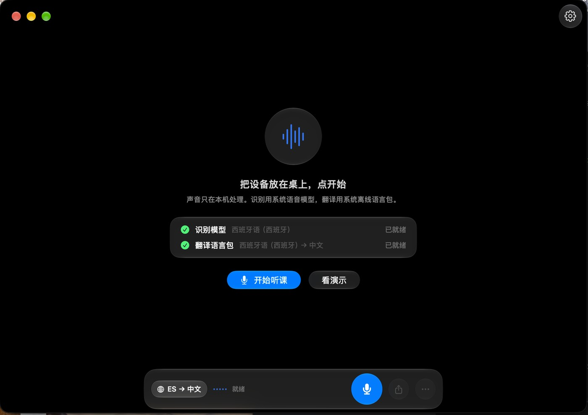

# Transclase · 课堂同传

> macOS 上的实时课堂双语字幕。全程本地运行，不需要注册，音频不出设备。



---

## 它解决什么问题

上课听不懂，通常不是"单词不认识"，而是三件事叠在一起：

1. **听不清** —— 教室太大、讲师有口音、后排有回声
2. **翻不准** —— 通用翻译软件不认识你专业的术语
3. **记不住** —— 听懂了，但两小时后全忘了

所以这个 App 不是"翻译器"，是**课堂同传 + 逐字稿**：把一节课变成能跟上的双语字幕，课后还能导出复习。

## 功能

- **实时双语字幕**：原文小字 + 译文大字，字号可调，可只留译文
- **稳定渲染**：每句按音频时间码生成行 ID，同一句只原地更新，永不跳行
- **底部对齐**：最新一句始终停在同一个阅读位置
- **离线准备**：首页显示识别模型 / 翻译语言包是否就绪，带真实下载进度
- **术语表**：课程级词表，纠正模型把专有名词、缩写原样留下的问题
- **模型管理**：查看本机已下载的识别与翻译模型
- **导出**：双语逐字稿（复制 / 分享），或只含原语言的 Markdown 文件（位置自选）
- **演示模式**：没有麦克风、没有语言包也能先看效果

## 系统要求

| | 要求 |
|---|---|
| 系统 | **macOS 26.0+**（`SpeechAnalyzer` 从这一代才有） |
| 芯片 | **Apple Silicon**（M1 及以后）。Intel 能打开，但实时识别不可用，只能看演示 |
| 构建 | Xcode 27 / Swift 6.4 |
| 可选 | Apple 智能（语言包缺失时的兜底翻译，需支持的设备） |

## 下载与安装

### 方式一：一行命令（推荐）

```bash
curl -fsSL https://raw.githubusercontent.com/JLZ0614/transclase/main/scripts/install.sh | bash
```

它会下载最新版、放进「应用程序」、去掉隔离标记，然后自动打开。
脚本很短，[可以先读一遍](scripts/install.sh)。

> 为什么用 `curl` 而不是浏览器下载：浏览器会给文件打上 `com.apple.quarantine` 标记，
> macOS 就会拦"未验证的开发者"。`curl` 不会打这个标记，所以装完直接能双击。

### 方式二：Homebrew

```bash
brew install --cask JLZ0614/transclase/transclase
```

升级 `brew upgrade --cask transclase`，卸载 `brew uninstall --cask transclase`。

### 方式三：手动下载

去 [**Releases**](https://github.com/JLZ0614/transclase/releases/latest) 下载 zip：

1. 解压，得到 `Transclase.app`、`install.command`、`安装说明.txt`
2. 打开「终端」，`cd` 进解压出来的目录，执行 `bash install.command`

**不要双击 `install.command`**：浏览器下载的脚本本身也带隔离标记，双击会被拦。

**如果已经被拦了**：macOS 15 起「右键 → 打开」不再管用。要走
`系统设置 → 隐私与安全性` → 拉到底 → 找到被拦的 Transclase → **仍要打开**。

### 方式四：从源码构建

```bash
git clone https://github.com/JLZ0614/transclase.git
cd transclase
open Transclase.xcodeproj   # Xcode 27，选 My Mac，⌘R
```

## 使用教程

### 1. 第一次打开

首页会有「离线准备」清单。点 **准备离线包**，把识别模型和当前语言对的语言包装好
（合计约 400–600 MB）。下载有百分比进度。

装好一次，之后上课全程离线。不想下载就先点 **看演示**。

### 2. 上课时怎么放

把 Mac 放在桌上，麦克风朝向讲师，尽量坐前 5 排。点底部控制栏中间的话筒按钮开始。

底部那条控制栏从左到右是：语言对 → 音量条 → 状态 → 开始/停止 → 分享 → 更多。

### 3. 术语表（最值得花 5 分钟的地方）

**设置 → 课程术语表**，把你这门课的行话填进去：

| 原文术语 | 译法 |
|---|---|
| gradient descent | 梯度下降 |
| opportunity cost | 机会成本 |
| randomized controlled trial | 随机对照试验 |

同一个词在一节课里保持同一种译法，比偶尔译得更漂亮更重要。

### 4. 课后复习

- `⋯` → **复制全文**：原文 + 译文
- `⋯` → **导出 Markdown 文件（仅原文）**：只含听到的原语言，保存位置自选
- 控制栏分享按钮：导出双语 Markdown，走系统分享

### 5. 快捷键

| 快捷键 | 作用 |
|---|---|
| `⌘R` | 开始 / 停止 |
| `⌘K` | 清空字幕（会二次确认） |

## 关于语言包（常见问题）

**Q：为什么一定要下语言包？不能直接用系统自带的吗？**

A：Apple 的翻译模型**就是**语言包本身，没有"预装好、随时可用"的版本。没下载时
`TranslationSession` 会直接抛 `notInstalled`，没有绕过方式。

**Q：那不下语言包就完全不能翻？**

A：不是。App 有三级降级：

| 顺序 | 引擎 | 前提 | 质量 |
|---|---|---|---|
| 1 | 系统离线翻译 | 该语言对语言包已下载 | 最好 |
| 2 | Apple 智能（端侧大模型） | 设备支持且已开启 | 中 |
| 3 | 仅原文 | 上面都不满足 | — |

**Q：语言包装在哪？删 App 会丢吗？**

A：由系统服务管理，是全局资产。App 拿不到文件，只能通过 API 调用。删 App 不会删包，
和系统「翻译」App 共用同一份；抹机或换 Apple ID 才会丢。

**Q：为什么设置里不能删除模型？**

A：Apple 没给接口。识别模型只有 `reserve`/`release`（管理预留名额），翻译框架完全没有
删除 API。识别模型由系统按磁盘压力自动清理；翻译语言包要去系统里删：
`系统设置 → 通用 → 语言与地区 → 翻译语言`。

## 工作原理

```
麦克风 (AVAudioEngine)
   │ PCM → AVAudioConverter
   ▼
SpeechAnalyzer + SpeechTranscriber      ← 系统端侧识别模型
   │ volatile / final 结果（带时间码）
   ▼
Translation（系统离线）→ 失败则 Apple 智能 → 再失败则仅原文
   ▼
按时间码定位同一行，原地替换（不新增、不重排）
```

两条通道写**同一行**：中间结果先上屏让你跟得上，句子结束后用更准的译文覆盖。

## 已知限制

- **暂不支持抓系统音频**：网课走麦克风回采，理论上可以做得更干净
- **运行中不能切语言**：避免一节课混进两种语言
- **模型下载期间无法取消**：开始后只能等它完成
- **没有说话人分离**：Apple 没有公开 API
- **只能装 macOS 26+、Apple Silicon**：系统框架的硬性要求

## 开发

```
Transclase/
├── App/            状态中心、入口
├── Audio/          麦克风采集、格式转换、电平
├── Speech/         识别引擎协议 + AppleSpeechEngine + 模型安装器
├── Translation/    翻译引擎协议 + Apple + Apple 智能兜底 + 术语表后处理
├── Pipeline/       采集 → 识别 → 翻译 → 渲染 编排
├── UI/             SwiftUI（Liquid Glass）
└── Support/        语言能力发现、导出格式、中文变体规范化
```

命令行构建：

```bash
xcodebuild -project Transclase.xcodeproj -scheme Transclase \
  -destination 'platform=macOS' -derivedDataPath ./build build
```

无头管线测试（不需要麦克风、不需要语言包）：

```bash
mkdir -p .hc/cache .hc/tmp
TMPDIR=$PWD/.hc/tmp swiftc -parse-as-library -module-cache-path .hc/cache \
  Transclase/Models/*.swift Transclase/Audio/AudioSource.swift Transclase/Support/*.swift \
  Transclase/Speech/*.swift Transclase/Translation/*.swift Transclase/Pipeline/*.swift \
  Transclase/App/AppModel.swift Harness/model-check.swift Harness/main.swift -o .hc/harness
./.hc/harness
```

> 在受限沙箱（CI）里构建时，Swift 宏需要 `-disable-sandbox`，本地 Xcode 不需要。

## 许可

MIT，见 [LICENSE](LICENSE)。

课堂录音在多数学校需要事先告知讲师；欧盟 GDPR、美国部分州要求所有在场者同意。
正式分发前请把录音提示做成强制流程，并准备隐私政策。
